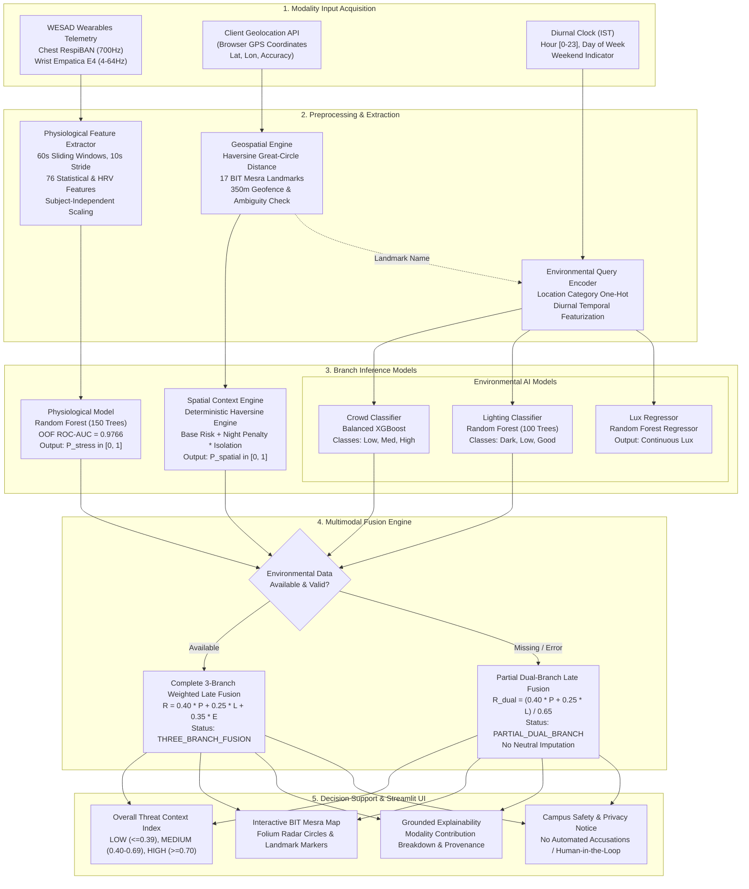

# Multimodal Threat Prediction Engine — Version 1.0
## Technical Documentation: Project Overview, Objectives, and System Architecture

---

### 1. Project Identification and Version
- **Project Title:** Multimodal Threat Prediction Engine
- **Academic Affiliation:** Department of Computer Science & Engineering, Birla Institute of Technology (BIT), Mesra, Ranchi, Jharkhand, India
- **System Version:** 1.0 (Production-Audited Baseline Architecture)
- **Primary Applications:** Streamlit Interactive Web Dashboard, Wearable Affective Monitoring, Campus Geospatial Safety System
- **Repository Root:** `E:\project1`
- **Target Academic Deliverable:** B.Tech Project Report & Technical Evaluation Manifest

---

### 2. Project Background and Context
Contemporary campus safety systems predominantly rely on reactive mechanisms such as physical panic alarms, emergency call boxes, or mobile SOS software. While functional in structured environments, these traditional mechanisms suffer from a foundational operational flaw: **they demand conscious, unhindered manual activation by a victim during acute distress**. In real-world physical threats, assault, harassment, or severe panic, victims are frequently incapacitated, physically restrained, or physiologically immobilized by shock (the "freeze" response), rendering manual alerts ineffective.

To mitigate this dependency, recent computational research has explored automated threat and distress assessment leveraging biometric telemetry (wearable physiological monitoring) and smart-environment Internet-of-Things (IoT) sensors. However:
1. **Isolated Biometric Sensing:** Biometric indicators alone (e.g., elevated heart rate, galvanic skin response spikes) are notoriously non-specific. Physiological arousal naturally accompanies non-threatening stimuli such as physical exertion, benign academic stress, surprise, or intense amusement. Relying strictly on biometric thresholds yields unacceptably high false-positive rates.
2. **Isolated Environmental Sensing:** Automated surveillance and geospatial risk metrics (e.g., late-night schedules, unlit forest perimeter sectors) generate persistent alerts regardless of whether an individual is actually experiencing distress.
3. **The Multimodal Imperative:** An accurate, dependable decision-support system requires the mathematical convergence of physiological distress signals with real-time geographic vulnerability and environmental context.

---

### 3. Problem Statement
The objective of this engineering and research project is to design, implement, audit, and benchmark a modular, multi-branch decision-support engine capable of:
1. Passively monitoring wearable physiological signals to infer acute somatic stress.
2. Continually analyzing live GPS coordinates against campus perimeter landmarks, security outposts, and isolation indices.
3. Predicting situational environmental vulnerabilities (crowd density, illumination, and illuminance in lux) based on diurnal schedules and landmark geography.
4. Intelligently fusing these disparate data streams into a calibrated contextual threat index while transparently handling sensor dropouts, GPS ambiguity, and missing modalities without fabricating data or silently substituting arbitrary neutral defaults.

---

### 4. Research and Engineering Objectives
The project was executed against five defined technical milestones:
1. **Objective 1 (Physiological Branch):** Process raw wearable telemetry from the benchmark WESAD (Wearable Stress and Affect Detection) dataset across 15 human subjects (chest RespiBAN and wrist Empatica E4), segment signals into sliding temporal windows, extract 76 verified time-domain and frequency-domain features, and train a subject-independent classifier (Random Forest) capable of discriminating stress from non-stress states with ROC-AUC $\ge 0.95$.
2. **Objective 2 (Spatial Branch):** Formulate a deterministic geospatial engine encompassing 17 verified BIT Mesra campus landmarks, calculating great-circle Haversine distances, perimeter geofencing ($350\,\text{m}$ maximum radius), security outpost proximity, and an algorithmic ambiguity detector that flags equidistant positions and enforces manual landmark confirmation.
3. **Objective 3 (Environmental Branch):** Generate a rigorous 180-day diurnal synthetic environmental dataset ($N = 73,440$ observations across 17 locations $\times$ 24 hours), train cost-sensitive machine learning models (Balanced XGBoost for crowd density, Random Forest for lighting category, and Random Forest for continuous lux regression), and resolve severe class imbalance on transitional states through cost-sensitive sample weighting.
4. **Objective 4 (Multimodal Fusion & Missing Data):** Implement a flexible late-fusion architecture ($R = 0.40P + 0.25L + 0.35E$) and engineer a mathematically sound weight-renormalization fallback ($R_{\text{dual}} = \frac{0.40P + 0.25L}{0.65}$) that activates whenever environmental inputs are missing or uncertain, rejecting silent neutral substitution.
5. **Objective 5 (Interactive Interface & Governance):** Develop a modern, responsive Streamlit dashboard featuring interactive Folium mapping, real-time telemetry inspection, unrounded biometric metric formatting, automated provenance disclosure, and an ethical campus safety and privacy governance framework.

---

### 5. Scope of the System
- **Geographic Boundary:** Specific to the physical topography of the Birla Institute of Technology, Mesra main campus ($23.4123^\circ\,\text{N}, 85.4399^\circ\,\text{E}$), encompassing 17 primary academic, residential, and perimeter zones.
- **Biometric Boundary:** Binary classification between Stress (WESAD Label 2) and Non-Stress (Baseline Label 1, Amusement Label 3, and Meditation Label 4).
- **Environmental Boundary:** Synthetic schedule simulation modeling typical weekday/weekend diurnal patterns for campus foot traffic and illumination.
- **Academic Integrity Constraint:** The system explicitly distinguishes between empirical physiological observations (WESAD) and synthetic simulation rules (environmental models). It does not claim to predict confirmed criminal assault, but rather evaluates an objective multidimensional vulnerability index.

---

### 6. Current Implementation Status
The project has reached **Version 1.0 Final Audited Status**:
- **Codebase Health:** Clean repository structure adhering to modular Python packaging standards.
- **Verification Suite:** 18 distinct test suites comprising **104 automated tests**, achieving a **100% pass rate** in $34.80$ seconds.
- **Dashboard Deployment:** Functional Streamlit interface operating in both local desktop environments and cloud hosting container environments.
- **Provenance Disclosures:** All UI components display prominent provenance pills distinguishing WESAD empirical models from synthetic simulation rules.

---

### 7. Major Technical Contributions
1. **Cost-Sensitive Class Balancing for Crowd Transition States:** Identified that standard gradient boosting classifiers suppressed the transitional `Medium` crowd category (yielding only $4.48\%$ recall). Implemented training-fold sample weighting ($w_c = \frac{N}{C \cdot N_c}$), improving `Medium` recall to $42.39\%$ (~$9.5\times$ improvement) and elevating Macro F1 from $0.5702$ to $0.6722$.
2. **Defensive Haversine Ambiguity Detection:** Engineered an automated ambiguity gate in the spatial branch. If coordinates fall within the GPS accuracy margin between two proximate landmarks ($|d_1 - d_2| \le \max(25\,\text{m}, \text{accuracy})$), the engine refuses to guess, halts automatic geofencing, and requires user manual confirmation.
3. **Elimination of Silent Neutral Substitution:** Overcame a common flaw in late-fusion architectures where missing sensor streams are silently imputed with arbitrary values (e.g., $0.20$ or $0.50$). Developed an explicit partial dual-branch formulation that renormalizes weights and communicates unavailable modality status directly to operators.
4. **WESAD Window Stride & Meditation Session Optimization:** Resolved physiological prediction artifacts by engineering `find_best_contiguous_window()`, locating the central contiguous 60-second slice of meditation sessions to prevent label corruption from transient boundary states.
5. **Centralized Timezone & Coordinate Resilience:** Implemented centralized IST time parsing and defensive coordinate unpacking that prevents runtime container crashes across varying client locales and legacy signatures.

---

### 8. System Architecture and End-to-End Workflow

#### 8.1 High-Level Architecture Diagram (Mermaid)

---

### 9. Detailed Explanation of the Three Analysis Branches

#### Branch 1: Physiological Stress Analysis
- **Empirical Data Source:** WESAD benchmark dataset, collected under laboratory stress conditions using RespiBAN chest straps ($700\,\text{Hz}$ recording ECG, EDA, EMG, respiration, temperature, and 3-axis accelerometer) and Empatica E4 wristbands (BVP at $64\,\text{Hz}$, EDA at $4\,\text{Hz}$, temperature at $4\,\text{Hz}$, and 3-axis accelerometer at $32\,\text{Hz}$).
- **Inference Pipeline:** A sliding 60-second window with a 10-second stride generates a comprehensive 76-dimensional feature vector. Extracted parameters include statistical moments (mean, variance, skewness, linear slope), heart rate variability metrics (peak counts, mean RR intervals, SDNN, and RMSSD), galvanic skin conductance levels, and body acceleration magnitudes.
- **Model Architecture:** A 150-tree Random Forest classifier (`max_depth=10`, `max_features='sqrt'`). Validated using 5-fold subject-independent GroupKFold cross-validation, achieving an overall accuracy of **$93.66\%$** and an ROC-AUC of **$0.9766$**.
- **Output:** A continuous biometric distress probability $P_{\text{physio}} \in [0.0, 1.0]$.

#### Branch 2: Spatial Context & Campus Geographic Analysis
- **Empirical Basis:** Geographic coordinates of 17 BIT Mesra campus landmarks, surveyed from OpenStreetMap (OSM) and campus spatial data.
- **Inference Pipeline:** Computes great-circle distances using the Haversine spherical trigonometric formula:
  $$d = 2R \arcsin \left( \sqrt{\sin^2\left(\frac{\Delta \phi}{2}\right) + \cos(\phi_1)\cos(\phi_2)\sin^2\left(\frac{\Delta \lambda}{2}\right)} \right)$$
  where $R = 6,371,000\,\text{m}$.
- **Geofence Enforcement:** Coordinates further than $350\,\text{m}$ from the nearest landmark trigger `OUTSIDE_CAMPUS_GEOFENCE`, requiring manual location selection.
- **Ambiguity Detection:** When $|d_1 - d_2| \le \max(25\,\text{m}, \text{accuracy})$, the status is flagged as `AMBIGUOUS_LOCATION`.
- **Deterministic Risk Scoring:**
  $$P_{\text{spatial}} = \min\left(1.0, \text{BaseRisk} + \text{NightPenalty} \times \text{SpatialIsolation}\right)$$
  where $\text{NightPenalty} = 0.25$ during nighttime hours ($19:00 - 05:00$) and $\text{SpatialIsolation} = \min(1.0, \text{BaseIsolation} + 0.2 \cdot \frac{d_{\text{center}}}{1000})$.
- **Output:** A bounded geographic vulnerability score $P_{\text{spatial}} \in [0.0, 1.0]$.

#### Branch 3: Environmental Context Prediction
- **Data Foundation:** 180-day diurnal simulation ($N = 73,440$ rows) encoding campus schedules across 17 locations, reflecting academic class hours, hostel return curfews, dining peaks, and perimeter isolation.
- **Machine Learning Classifiers:**
  - **Crowd Classifier:** Balanced XGBoost (`n_estimators=100`, `max_depth=6`, `learning_rate=0.1`, `objective='multi:softprob'`). Evaluated on chronological test days 151–180: Test Accuracy = **$71.32\%$**, Macro F1 = **$0.6722$**.
  - **Lighting Classifier:** Random Forest (`n_estimators=100`, `max_depth=10`). Test Accuracy = **$88.46\%$**, Macro F1 = **$0.7833$**.
  - **Continuous Lux Regressor:** Random Forest Regressor (`n_estimators=100`). Test MAE = $378.1\,\text{lx}$, Test $R^2 = 0.7571$.
- **Situational Vulnerability Transformation:**
  $$P_{\text{env}} = \min(1.0, \max(0.05, \text{TimeFactor} + \text{LightingFactor} + \text{CrowdFactor}))$$
  where low crowd ($0.32$) and dark lighting ($0.35$) maximize environmental vulnerability.
- **Output:** A situational environmental score $P_{\text{env}} \in [0.05, 1.00]$.

---

### 10. Implementation Matrix: Completed vs. Proposed

| Feature / Capability | Implementation Status | Implementation File / Evidence | Notes |
| :--- | :--- | :--- | :--- |
| WESAD Feature Extraction (76 Feats) | **Implemented & Verified** | `src/physiological/feature_extraction.py` | 60s window, 10s stride, HRV + statistical |
| Subject-Independent RF Stress Model | **Implemented & Verified** | `models/physiological/physiological_model.pkl` | 150 trees, ROC-AUC = 0.9766, 15 subjects |
| 17 BIT Mesra Campus Landmarks DB | **Implemented & Verified** | `src/location/landmarks.py`, `config.py` | Coordinates, base risk, isolation indices |
| Haversine Distance & Geofencing | **Implemented & Verified** | `src/location/campus_map.py` | 350m geofence, 6371km Earth radius |
| GPS Ambiguity Detection Algorithm | **Implemented & Verified** | `src/environment/model.py`, `app/main.py` | 25m margin check; prompts user override |
| Manual Landmark Override System | **Implemented & Verified** | `app/main.py` lines 610–650 | Bypasses GPS when requested; reactive rerun |
| Diurnal Environmental Generator | **Implemented & Verified** | `src/environment/generate_synthetic_dataset.py` | 73,440 rows, 180 days, train/val/test split |
| Balanced XGBoost Crowd Model | **Implemented & Verified** | `models/environment/crowd_model.pkl` | Sample-weighted; Medium recall 42.39% |
| Random Forest Lighting & Lux Models | **Implemented & Verified** | `models/environment/lighting_model.pkl` | Lighting F1 = 0.7833; Lux R² = 0.7571 |
| Complete 3-Branch Late Fusion | **Implemented & Verified** | `src/fusion/predict.py`, `src/fusion/meta_learner.py`| Formula: R = 0.40P + 0.25L + 0.35E |
| Partial Dual-Branch Renormalization | **Implemented & Verified** | `src/fusion/predict.py`, `src/fusion/fusion_engine.py`| Formula: R = (0.40P + 0.25L)/0.65; No neutral filler |
| Streamlit Cloud Interactive Dashboard | **Implemented & Verified** | `app/main.py`, `app/components/` | Responsive layout, Folium map, provenance pills |
| Dynamic Gating Network Architecture | **Implemented (Research Prototype)** | `src/fusion/dynamic_gating.py` | 2-layer MLP Softmax gating; falls back to static baseline |
| Production Stacking Meta-Learner | **Implemented (Gated Untrained)** | `src/fusion/stacking_pipeline.py` | Gated: Rejects demo weights without ground-truth labels |
| Physical IoT Optical / Lux Hardware | **Proposed (Future Scope)** | Documented in `05_ENVIRONMENTAL_DATASET_GENERATION.md` | Requires ESP32/LoRa node hardware deployment |
| Real-Time BLE Smartwatch Companion | **Proposed (Future Scope)** | Documented in `11_FUTURE_SCOPE_AND_LIMITATIONS.md` | Requires WearOS BLE client application |

---

### 11. Core Scientific and Technical Limitations
1. **Affective Laboratory Stress vs. Physical Danger:** WESAD induces social-evaluative stress (Trier Social Stress Test) and cognitive arithmetic stress. It does not contain recordings of genuine physical violence, combat, or predatory stalking. While physiological correlates (sympathetic arousal, vagal withdrawal) are similar, transferability to street threats requires empirical clinical verification.
2. **Deterministic Schedule Rules vs. Dynamic Reality:** The environmental models learn schedule regularities (e.g., library closes at 21:00). They cannot detect unplanned campus events, sudden power failures, weather cloudbursts, or spontaneous gatherings without real-time physical photometer/acoustic IoT nodes.
3. **Absence of Ground-Truth Multimodal Assault Dataset:** Because no synchronized dataset exists where real-world attacks are paired simultaneously with WESAD wearable signals, GPS trajectories, and lux readings, training a fully supervised end-to-end deep meta-learner is scientifically unjustifiable without introducing data fabrication. Hence, Version 1.0 strictly adheres to late fusion with transparent baseline weighting.
