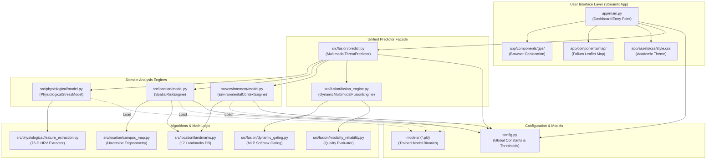

# Multimodal Threat Prediction Engine — Version 1.0
## Technical Documentation: Repository Architecture, Codebase Structure, and System Design

---

### 1. Curated Repository Directory Structure
Below is the structural layout of the codebase (excluding Python virtual environments `.venv`, Git metadata `.git`, raw binary datasets `data/WESAD/`, and temporary bytecode caches `__pycache__`):

```text
E:\project1
├── app/                                    # Streamlit Web Application Layer
│   ├── components/                         # Custom Frontend UI Components
│   │   ├── gps/
│   │   │   └── index.html                  # HTML5 Geolocation API Integration Component
│   │   └── map/
│   │       └── map_component.py            # Folium Leaflet Map Renderer & Radar Layer
│   ├── assets/
│   │   ├── css/
│   │   │   └── style.css                   # Medical / Academic High-Contrast Styling
│   │   └── img/
│   └── main.py                             # Streamlit Application Main Entry Point (1,394 lines)
├── config.py                               # Global Configuration, Constants & Landmarks DB
├── data/                                   # Data Layer (Summaries, Features & Datasets)
│   ├── content/                            # Content Modality Synthetic Demo Artifacts
│   ├── context/                            # Context Modality Synthetic Demo Artifacts
│   ├── environment/                        # Environmental Datasets & Baseline Workbook
│   │   ├── BIT_Mesra_Campus_Crowd_Dataset(1).xlsx  # Baseline Schedule Workbook
│   │   └── BIT_Mesra_Synthetic_Environmental_Dataset.csv # 73,440-row Generated Dataset
│   ├── fusion/                             # Fusion Modality Benchmark Data
│   ├── location/                           # Geospatial Landmark Datasets
│   └── physiological/                      # Physiological Feature Tables & Audits
│       ├── physiological_features.csv      # Extracted 76-Feature WESAD Dataset (4,325 rows)
│       ├── wesad_condition_audit.json      # Verified 15-Subject Condition Audit
│       └── wesad_condition_summary.csv     # Subject Telemetry Summary Table
├── docs/                                   # Architectural & Academic Documentation
│   ├── DATASET_AND_LABEL_REQUIREMENTS.md   # Ground-Truth Multimodal Requirements
│   ├── MODEL_EVALUATION.md                 # Evaluation Reports & Baseline Metrics
│   ├── SCIENTIFIC_LIMITATIONS.md           # Theoretical & Empirical Boundaries
│   ├── STACKING_METHODOLOGY.md             # Ensemble Stacking Formulation
│   └── TECHNICAL_ARCHITECTURE.md           # System Architecture & Math Specs
├── models/                                 # Serialized Machine Learning Model Artifacts
│   ├── content/content_model.pkl
│   ├── context/context_model.pkl
│   ├── environment/
│   │   ├── crowd_model.pkl                 # Balanced XGBoost Crowd Classifier (1.2 MB)
│   │   ├── environment_model.pkl           # Baseline Decision Model
│   │   └── lighting_model.pkl              # Random Forest Lighting & Lux Model (15.6 MB)
│   ├── fusion/
│   │   └── fusion_model.pkl                # Late Fusion Configuration
│   ├── location/location_model.pkl
│   └── physiological/
│       └── physiological_model.pkl         # 150-Tree Random Forest Classifier (1.5 MB)
├── notebooks/                              # Exploratory Data Analysis & Prototyping
│   ├── 01_wesad_exploration.ipynb          # Raw WESAD Signal Visualization
│   ├── explore_wesad.py                    # Automated WESAD Exploration Script
│   ├── run_stacking_experiments.py         # Multi-Branch Benchmark Simulator
│   └── plots/                              # Generated Exploratory Visualizations
├── reports/                                # Generated Evaluation Metrics & CSVs
│   ├── environmental_models/
│   │   ├── crowd_model_comparison.csv      # Crowd Classifier Performance Benchmark
│   │   ├── lighting_model_comparison.csv   # Lighting Classifier Performance Benchmark
│   │   └── environmental_model_evaluation.md # Formal Environmental Audit Report
│   └── synthetic_simulation/
│       ├── stacking_benchmark_results_synthetic_demo.csv
│       └── stacking_benchmark_results_synthetic_demo.json
├── src/                                    # Core Python Source Packages
│   ├── environment/                        # Environmental AI Package
│   │   ├── generate_synthetic_dataset.py   # 180-Day Diurnal Simulation Generator
│   │   ├── model.py                        # EnvironmentalContextEngine (Inference)
│   │   ├── oof_generator.py                # Out-Of-Fold Cross-Validation Utilities
│   │   └── train.py                        # Cost-Sensitive Training Pipeline
│   ├── fusion/                             # Multimodal Late & Dynamic Fusion Package
│   │   ├── calibration.py                  # Platt Scaling & Isotonic Calibration
│   │   ├── dynamic_gating.py               # 2-Layer MLP Dynamic Gating Network
│   │   ├── feature_schema.py               # Canonical 15-D Gating Feature Vector
│   │   ├── fusion_config.py                # Enums, Freshness Timeouts & Policies
│   │   ├── fusion_engine.py                # DynamicMultimodalFusionEngine Orchestrator
│   │   ├── meta_learner.py                 # MultiOutputMetaLearner & Baseline Stacker
│   │   ├── modality_reliability.py         # Sensor Quality & Missing-Data Compensator
│   │   ├── predict.py                      # MultimodalThreatPredictor (Unified Facade)
│   │   └── stacking_pipeline.py            # Level-1 Production-Gated Stacking Engine
│   ├── location/                           # Spatial & Geospatial Analysis Package
│   │   ├── campus_map.py                   # CampusMapAnalyzer & Haversine Math
│   │   ├── landmarks.py                    # Central 17 BIT Mesra Landmarks Database
│   │   ├── model.py                        # SpatialRiskEngine Standardized Interface
│   │   └── train.py                        # Spatial Prototype Model Trainer
│   └── physiological/                      # Physiological Signal Processing Package
│       ├── feature_extraction.py           # 60s Sliding Window Feature Extractor
│       ├── inspect_wesad.py                # Signal Sanity & Data Quality Inspector
│       ├── model.py                        # PhysiologicalStressModel Interface
│       ├── preprocessing.py                # Multi-Rate Wearable Signal Loader
│       ├── train.py                        # GroupKFold Subject-Independent Trainer
│       └── visualize_signals.py            # Waveform Plotting Utility
├── tests/                                  # Unit, Regression, and Integration Test Suite
│   ├── test_audit_v1_corrections.py        # 15 Phase-0 Audit Acceptance Tests
│   ├── test_base_models.py                 # Base Model Inference Unit Tests
│   ├── test_config_and_campus.py           # Landmark Coordinates & Config Integrity
│   ├── test_environmental_pipeline_resilience.py # Environmental Fault Tolerance Tests
│   ├── test_environmental_prediction.py    # Crowd & Lighting Model Validation Tests
│   ├── test_environmental_time_resilience.py # IST Time & Locale Resilience Tests
│   ├── test_evaluation_metrics.py          # Metric Calculation & Confusion Matrix Tests
│   ├── test_fusion_button_resilience.py    # Streamlit Threat Evaluation Callback Tests
│   ├── test_manual_override_resilience.py  # Manual GPS Override State Tests
│   ├── test_meta_learner.py                # Stacking & Late Fusion Benchmark Tests
│   ├── test_oof_generator.py               # Cross-Validation Generator Integrity Tests
│   ├── test_predictor_integration.py       # End-to-End MultimodalThreatPredictor Tests
│   ├── test_production_integrity.py        # Provenance Gating & Anti-Fabrication Tests
│   ├── test_stacking_pipeline.py           # Level-1 Stacking Serialization Tests
│   ├── test_terminology_compliance.py      # Academic Terminology Compliance Tests
│   ├── test_ui_audit_v1.py                 # Streamlit UI Rendering & Component Tests
│   ├── test_wesad_subject_switching.py     # Multi-Subject WESAD Data Isolation Tests
│   └── verify_e2e_scenarios.py             # Full System Operational Integration Scenarios
└── requirements.txt                        # Pin-Versioned Python Dependencies
```

---

### 2. Functional Description of Core Modules

#### 2.1 Configuration Layer (`config.py`)
- **Role:** Central source of truth for runtime constants, geographic parameters, subject identifiers, and sampling rates.
- **Key Symbols:**
  - `BIT_MESRA_CENTER`: Tuple defining campus centroid (`lat=23.41230, lon=85.43990`).
  - `BIT_MESRA_LANDMARKS`: List of 17 landmark dictionaries populated from `src/location/landmarks.py`.
  - `ALL_SUBJECTS`: List of 15 usable WESAD subject IDs (`['S2', 'S3', ..., 'S17']`).
  - `SAMPLING_FREQ`: Dictionary of sensor frequencies (`chest: 700`, `wrist_ACC: 32`, `wrist_BVP: 64`, `wrist_EDA: 4`, `wrist_TEMP: 4`).
  - `RISK_THRESHOLDS`: Decision boundaries (`LOW_MAX = 0.39`, `MEDIUM_MAX = 0.69`).
  - `get_current_ist_time()`: Standardized datetime provider returning Asia/Kolkata timezone time dictionary.

#### 2.2 Physiological Package (`src/physiological/`)
- `preprocessing.py`:
  - `load_subject_data(subject_id: str) -> Dict[str, Any]`: Unpickles subject pickle files, standardizes keys (`signal -> chest, wrist`), and verifies array lengths.
- `feature_extraction.py`:
  - `extract_window_features(subject_id, chest_signals, wrist_signals, labels, start_sec, window_sec=60.0) -> Tuple[Dict, int]`: Slices synchronized chest and wrist arrays into 60-second windows with a 10-second stride. Extracts statistical parameters and HRV metrics.
  - `compute_signal_features(arr, prefix) -> Dict[str, float]`: Computes mean, standard deviation, minimum, maximum, skewness, and linear slope.
  - `compute_ecg_bvp_features(arr, fs, prefix) -> Dict[str, float]`: Uses peak detection (`scipy.signal.find_peaks`) to extract inter-beat intervals, heart rate (BPM), mean RR, standard deviation of RR, and RMSSD.
- `train.py`:
  - `train_and_evaluate_physiological_models()`: Executes 5-fold subject-independent `GroupKFold` cross-validation across subjects. Trains Logistic Regression, Random Forest (150 trees), and XGBoost. Serializes the optimal model (`physiological_model.pkl`).
- `model.py`:
  - `PhysiologicalStressModel`: High-level inference facade. Accepts raw 76-dimensional feature vectors or subject IDs, performing standardization and returning $P(\text{Stress})$.

#### 2.3 Spatial Package (`src/location/`)
- `landmarks.py`:
  - `BIT_MESRA_LANDMARKS_DB`: Comprehensive dictionary defining 17 landmarks, geographic coordinates, geofence radius, isolation index, base risk, and distance to security post.
- `campus_map.py`:
  - `haversine_distance(lat1, lon1, lat2, lon2) -> float`: Implements spherical trigonometry to calculate great-circle distance in meters using Earth radius $R = 6,371,000\,\text{m}$.
  - `CampusMapAnalyzer.analyze_gps(lat, lon, accuracy, time_of_day_hour) -> Dict`: Resolves nearest landmark, checks geofence radius ($350\,\text{m}$), and computes situational geographic vulnerability.
- `model.py`:
  - `SpatialRiskEngine`: Standardized inference class providing `predict_score(lat, lon, ...)` with deterministic fallback.

#### 2.4 Environmental Package (`src/environment/`)
- `generate_synthetic_dataset.py`:
  - `generate_synthetic_environmental_dataset(seed=42) -> pd.DataFrame`: Generates 73,440 records across 180 simulated days using BIT Mesra baseline schedule rules and stochastic perturbations.
- `train.py`:
  - `train_environmental_models()`: Trains Balanced XGBoost (`multi:softprob`) using sample weights $w_c = \frac{N}{C \cdot N_c}$, Random Forest lighting classifier, and Random Forest lux regressor. Serializes `crowd_model.pkl` and `lighting_model.pkl`.
- `model.py`:
  - `EnvironmentalContextEngine`: Loads models, resolves campus landmarks defensively, evaluates ML inference, and outputs calibrated situational context scores.

#### 2.5 Multimodal Fusion Package (`src/fusion/`)
- `predict.py` (`MultimodalThreatPredictor`):
  - Unified system interface tying together physiological, spatial, and environmental engines.
  - `predict_fusion(physiological_stress_score, location_risk_score, environment_risk_score, ...)`: Coordinates 3-branch weighted fusion ($0.40P + 0.25L + 0.35E$) and partial dual-branch fallback ($(0.40P + 0.25L)/0.65$).
- `fusion_engine.py` (`DynamicMultimodalFusionEngine`):
  - Manages modality reliability, missing-data compensation, dynamic gating, and grounded explainability.
- `dynamic_gating.py` (`DynamicGatingNetwork`):
  - 2-layer MLP Softmax gating network ($\boldsymbol{\alpha} = \text{Softmax}(W_2 \cdot \text{ReLU}(W_1 X + b_1) + b_2)$). Flags un-trained status and safely reverts to baseline weights during production operation.
- `stacking_pipeline.py`:
  - Enforces production provenance gating, rejecting uncalibrated synthetic demo ensembles.

#### 2.6 Application Layer (`app/`)
- `main.py`:
  - Streamlit dashboard implementing two main tabs:
    - **Tab 1:** Multimodal Threat Prediction Dashboard (3 Branch Cards, Manual Location Override, Primary Threat Evaluation, Overall Contextual Risk Level Panel, Modality Contribution Breakdown, Ethical Notice).
    - **Tab 2:** BIT Mesra GPS & Spatial Analyzer (Live Coordinate Telemetry, Interactive Folium Map with Radar Circle, Nearest Landmark Distance Table).

---

### 3. Software Architecture Diagram (Mermaid)



---

### 4. Inter-Module Dependency and Data Flow Matrix

| Caller Module | Callee Module | Function / Method Invoked | Data Transferred | Return Value |
| :--- | :--- | :--- | :--- | :--- |
| `app/main.py` | `src/fusion/predict.py` | `predict_fusion()` | $P_{\text{stress}}, P_{\text{spatial}}, P_{\text{env}}$ | Full threat assessment dictionary |
| `app/main.py` | `src/fusion/predict.py` | `predict_environment_context()` | `location, hour, day, is_weekend` | Crowd/Lighting predictions + $P_{\text{env}}$ |
| `app/main.py` | `src/location/campus_map.py`| `CampusMapAnalyzer.analyze_gps()` | `lat, lon, accuracy, hour` | Nearest landmark, distance, geofence status |
| `src/fusion/predict.py` | `src/environment/model.py` | `predict_environment()` | `location, hour_of_day, ...` | Prediction payload with confidence and score |
| `src/fusion/predict.py` | `src/location/model.py` | `predict_score()` | `lat, lon, accuracy, hour` | Bounded spatial score $P_{\text{spatial}} \in [0, 1]$ |
| `src/fusion/predict.py` | `src/physiological/model.py`| `predict_stress()` | 76-D feature vector / Subject ID | Stress probability $P_{\text{stress}} \in [0, 1]$ |
| `src/environment/model.py` | `src/location/campus_map.py`| `haversine_distance()` | Two coordinate pairs $(\phi_1, \lambda_1), (\phi_2, \lambda_2)$ | Great-circle distance in meters |
| `src/physiological/train.py` | `src/physiological/preprocessing.py` | `load_subject_data()` | Subject ID string (`'S2'`) | Raw multi-rate sensor dictionaries |

---

### 5. Architectural Quality Attributes

#### 5.1 Error Handling and Defensive Programming
1. **Defensive Kwargs Unpacking:** All public resolution methods (`resolve_campus_location`) accept `**kwargs` and implement nested `try...except TypeError` blocks, ensuring that varying calling conventions or legacy signatures never crash runtime scripts.
2. **Missing Modality Graceful Degradation:** When environmental model binaries fail to deserialize or inputs are `None`, the system assigns `status="UNAVAILABLE"` and gracefully routes the decision through the partial dual-branch engine without unhandled exceptions.
3. **Finite Float Safeguards:** All numerical inputs to trigonometric and scoring functions are validated using `np.isfinite()`. Non-finite or `NaN` inputs are defensively clipped or assigned audited median values.

#### 5.2 Logging Architecture
- The system employs Python's standard `logging.getLogger(__name__)` configured across all core packages.
- Log outputs include formatted timestamps, module names, log levels (`INFO`, `WARNING`, `ERROR`), and structured payload summaries (e.g., `predict_fusion: P=0.2000, L=0.6000, E=0.2800 -> mode=THREE_BRANCH_FUSION`).
- In Streamlit Cloud environments, `flush=True` print statements provide immediate visibility in cloud runtime log viewers.

#### 5.3 Data Validation and Schema Enforcement
- **Canonical Feature Schema:** Defined in `src/fusion/feature_schema.py`, enforcing an exact 15-dimensional vector for dynamic gating and a 7-dimensional vector for meta-learning.
- **Target Boundaries:** Threat scores are strictly clamped to the interval $[0.0, 1.0]$. Probabilities violating mathematical boundaries trigger validation warnings and automatic defensive clipping.
