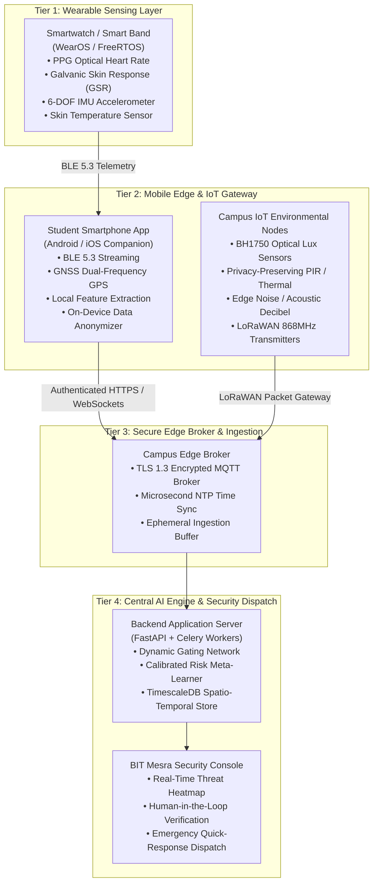
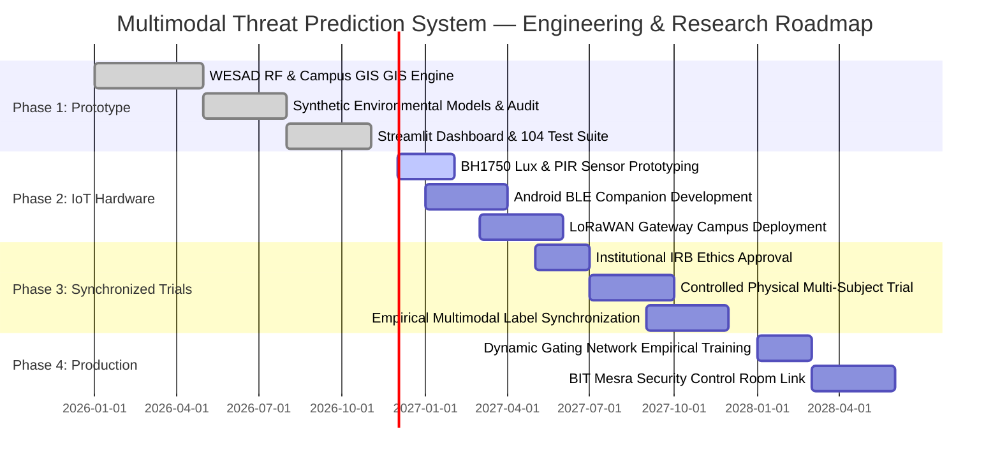

# Multimodal Threat Prediction Engine — Version 1.0
## Technical Documentation: Current Limitations, Future Architecture, and Research Roadmap

---

### 1. In-Depth Analysis of Current Limitations

#### 1.1 Empirical Dataset Boundaries (Affective Stress vs. Physical Danger)
- **The Core Boundary:** The physiological branch is trained on the benchmark **WESAD** dataset, which captures affective laboratory stress induced by the Trier Social Stress Test (TSST) and mental arithmetic.
- **The Domain Gap:** While social-evaluative stress induces measurable autonomic nervous system responses (sympathetic arousal, vagal withdrawal, tachycardia, galvanic skin response bursts, and vasoconstrictive cooling), it is fundamentally distinct from the acute terror, visceral panic, physical struggle, or motor immobilization associated with violent assault, stalking, or immediate physical danger.
- **Academic Distinction:** The physiological model accurately detects **acute somatic and cognitive stress**. It must not be conflated with an infallible detector of confirmed criminal threat without real-world empirical validation.

#### 1.2 Synthetic Environmental Dataset Limitations
- **Schedule Simulation Constraint:** The environmental dataset ($N = 73,440$) is synthetically generated from schedule simulation rules. High model accuracies ($88.46\%$ on lighting, $71.32\%$ on crowd) indicate that the algorithms have successfully learned the deterministic schedule mappings (e.g., classes end at 17:00, perimeter hostels lack lampposts).
- **Inability to Sense Dynamic Reality:** The current system cannot detect unplanned gatherings (e.g., campus protests, sports celebrations), impromptu power grid blackouts, dense monsoon storms, or localized physical obstructions without real-time physical sensing hardware.

#### 1.3 Absence of Synchronized Ground-Truth Threat Data
- In machine learning literature, true supervised multimodal fusion requires simultaneous recordings of $(\mathbf{x}_{\text{physio}}, \mathbf{x}_{\text{spatial}}, \mathbf{x}_{\text{env}})$ paired with empirical ground-truth threat outcome labels $y \in \{0, 1\}$.
- Because no such dataset ethically or physically exists on campus today, training an end-to-end deep neural network or second-level stacking ensemble would require fabricating outcome labels. Version 1.0 deliberately avoids this, relying on the transparent, un-fabricated Weighted Late Fusion baseline.

#### 1.4 Consumer Smartphone GPS Uncertainty
- Standard mobile browser Geolocation APIs rely on cell-tower triangulation, Wi-Fi BSSID mapping, and assisted GPS (A-GPS).
- In dense hostel corridors or under thick forested canopies near Hostels 11–13, satellite multipath propagation can degrade positioning accuracy from $\pm 5\,\text{m}$ to $\pm 60\,\text{m}$. While the ambiguity detector prevents erroneous landmark snapping, real-world deployment requires Bluetooth Low Energy (BLE) indoor micro-beacons.

---

### 2. Proposed Future Architecture: Wearables, IoT, and Edge Infrastructure

To transition from the Version 1.0 research prototype to an operational smart-campus defense platform, we propose a four-tier distributed Internet-of-Things (IoT) architecture:

#### Detailed Subsystem Specifications

##### 1. Wearable Physiological Node (Tier 1)
- **Hardware:** Commercial smartwatch (e.g., Samsung Galaxy Watch, Garmin, or open-source Bangle.js) running a low-power background companion daemon.
- **Sensors:** Multi-wavelength Photoplethysmography (PPG) sampled at $25\,\text{Hz}$ (capturing pulse rate and HRV), continuous Galvanic Skin Response (GSR) electrodes sampled at $4\,\text{Hz}$, and a 6-axis IMU sampled at $50\,\text{Hz}$ to capture violent motor agitation or sudden falls.

##### 2. Mobile Edge Companion Application (Tier 2)
- **Functions:** Gathers BLE telemetry from the wearable, captures dual-frequency L1/L5 GNSS satellite coordinates, executes on-device sliding-window feature extraction, and hashes student identities using cryptographic salts to preserve anonymity.

##### 3. Campus Environmental IoT Sensing Nodes (Tier 2)
- **Hardware:** Solar-powered ESP32-S3 IoT nodes deployed on campus streetlights and hostel perimeter walls.
- **Sensors:**
  - **Illuminance:** BH1750 digital ambient light sensors ($1 - 65,535\,\text{lx}$).
  - **Crowd Density:** Passive Infrared (PIR) motion arrays or low-resolution $8 \times 8$ thermal sensors (e.g., Panasonic Grid-EYE), counting human bodies without capturing identifiable facial imagery or invading personal privacy.
  - **Acoustic Outlier Sensor:** Edge decibel meter flagging sudden high-energy acoustic screams or impacts ($> 85\,\text{dB}$).
- **Communication:** Long-Range (LoRaWAN) transmitters transmitting hourly aggregates to a central campus gateway.

##### 4. Central Inference Engine & Security Dispatch Console (Tiers 3 & 4)
- **Backend:** High-throughput asynchronous FastAPI backend running on institutional servers, backed by TimescaleDB for spatial-temporal telemetry storage.
- **Decision Engine:** Evaluates the Dynamic Gating Network and calibrated multi-output risk heads.
- **Human-in-the-Loop Oversight:** The system operates strictly as decision support. Alerts trigger a secondary operator review protocol (e.g., audio callback, nearest guard check) rather than automated police actions or campus accusations.

---

### 3. Implementation Roadmap

---

### 4. Ethical, Privacy, and Campus Safety Governance

1. **Informed Consent & Voluntary Enrollment:** Participation in wearable telemetry monitoring must be entirely opt-in with explicit, revocable student consent.
2. **Biometric Data Minimization:** Raw biological signals (ECG waveforms, PPG streams) should be processed at the mobile edge; only aggregated 60-second statistical vectors should be transmitted over the network.
3. **Strict Zero-Accusation Policy:** The system assesses personal vulnerability and environmental risk to dispatch medical or security assistance. It must never be used for disciplinary surveillance, attendance tracking, curfew policing, or automated criminal accusations.
4. **Data Retention & Encryption:** Spatio-temporal telemetry must be encrypted using AES-256 at rest and TLS 1.3 in transit, with ephemeral storage automatically purged after 48 hours unless flagged in an active emergency investigation.
